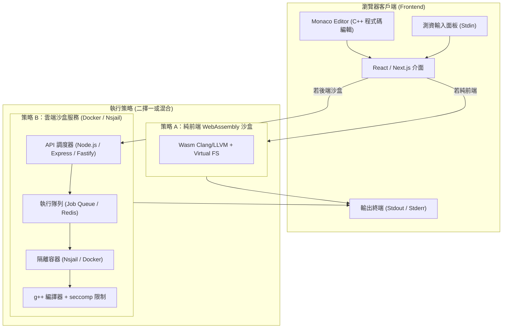

# 系統架構與技術選型：C++ 線上 IDE (Architecture & Tech Stack)

> 規範階段：/plan  
> 依據：[Addy Osmani - Planning & Task Breakdown](https://github.com/storynow01-arch/agent-skills/tree/main/skills/planning-and-task-breakdown)

---

## 1. 系統架構圖 (Architecture Overview)

---

## 2. 兩種執行架構對比

| 評估維度 | 策略 A：純前端 WebAssembly (Wasm) | 策略 B：後端 Docker/Nsjail 沙盒 |
|---|---|---|
| **伺服器負載** | 0 伺服器運算負擔，使用者本機運算 | 需雲端 CPU/記憶體資源支援編譯 |
| **資安風險** | 零主機逃逸風險（受瀏覽器沙盒限制） | 需極嚴格 Seccomp、cgroups、Namespace |
| **部署複雜度** | 極低（純靜態網站，可放 Vercel / GitHub Pages） | 需維運專用 Linux 主機或容器伺服器 |
| **功能完整性** | STL 與常用演算法 100% 支援；部分底層 POSIX 不支援 | 完整原生 Linux C++ 功能 |
| **首載體積** | 需載入約 15~25MB 的 Wasm 工具鏈 | 輕量前端頁面 (< 1MB) |

---

## 3. 建議推進階段 (Phased Implementation Plan)

- **Phase 1（MVP 規格驗證）**：
  - 前端現代化 Monaco Editor 介面、主題、C++ 模板選擇。
  - 設計統一的執行抽象介面 (`ExecutionEngine` Interface)，解耦前端與編譯核心。
- **Phase 2（編譯執行引擎對接）**：
  - 實作主要執行策略（優先推薦 WebAssembly 引擎以達到零主機成本，或搭建 Docker 執行容器）。
- **Phase 3（測試與安全強化）**：
  - 進行邊界測試：無窮迴圈、記憶體爆炸、大型測資、惡意系統呼叫攔截。
- **Phase 4（分享與保存）**：
  - 程式碼儲存、短網址分享、題目測資庫範本。
